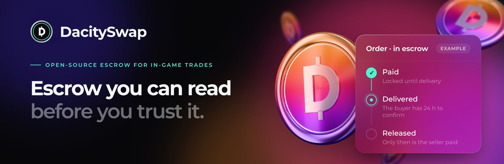
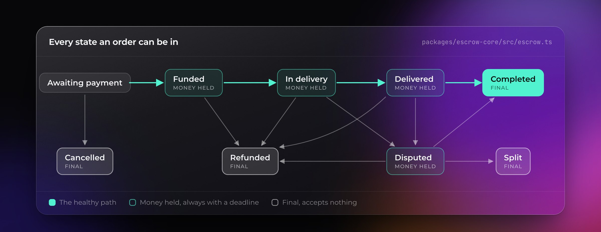

<div align="center">

<a href="https://docs.dacityswap.com"></a>

<br />

**The buyer's money waits in escrow until the seller has delivered,<br />and the code that decides when it moves is open source.**

<br />

[](https://github.com/Nels0nx/dacityswap/actions/workflows/ci.yml)
[](https://docs.dacityswap.com)
[](LICENSE)
[](https://docs.dacityswap.com/security/audits)
[](https://docs.dacityswap.com/security/audits)

[**Documentation**](https://docs.dacityswap.com) &nbsp;·&nbsp;
[How escrow works](https://docs.dacityswap.com/guide/how-escrow-works) &nbsp;·&nbsp;
[Run an order yourself](https://docs.dacityswap.com/guide/try-it) &nbsp;·&nbsp;
[The contract](packages/contracts/src/DacityEscrow.sol) &nbsp;·&nbsp;
[Security model](https://docs.dacityswap.com/security/model)

<br />

|    **101**    |       **96**        |        **4**        |        **98 %**        |        **0**        |
| :-----------: | :-----------------: | :-----------------: | :--------------------: | :-----------------: |
| tests passing | shared test vectors | contract invariants | contract line coverage | engine dependencies |

</div>

> [!NOTE]
> **Pre-launch.** The code that runs a trade is finished and tested. Trading opens once the
> company, a licensed payment partner and a legal opinion are in place, which is the work under
> way now. The contract is **unaudited** and not deployed, and no real money moves through any
> of this yet. [Current status →](https://docs.dacityswap.com/security/audits)

## Why

Trading game items for money is a trade between strangers, and one side has to go first. The
usual answer is "trust the platform", with no way to check what the platform does with the
money. DacitySwap publishes the part that matters instead:

- **the state machine** that decides when money may move,
- **the fee engine** that prices every quote and payout,
- **the contract** that holds stablecoin payments.

What you read here is what runs.

## How a trade works



1. **The buyer pays.** The money is locked. The seller has received nothing.
2. **The seller accepts and delivers** in the game, then marks the order delivered.
3. **The buyer confirms**, and the seller is paid. Silence for 24 hours counts as confirmation.
4. **If they disagree**, either side opens a dispute. The money freezes and an arbiter releases
   it, refunds it or divides it.

Every state that holds money has a deadline, and when it passes, whoever was kept waiting gets
the money. Nothing can be held for ever: not by a seller, a buyer, an arbiter or the platform.

| The escrow is waiting for | Window  | If it passes          |
| ------------------------- | ------- | --------------------- |
| The buyer to pay          | 30 min  | The order lapses      |
| The seller to accept      | 12 h    | The buyer is refunded |
| The seller to deliver     | 24 h    | The buyer is refunded |
| The buyer to confirm      | 24 h    | The seller is paid    |
| The arbiter to rule       | 14 days | The buyer is refunded |

## What you can verify

Each line is enforced by code in this repository and covered by a test.

| Guarantee                                                            | Where                                                                                       |
| -------------------------------------------------------------------- | ------------------------------------------------------------------------------------------- |
| An order moves only along declared transitions; anything else throws | [`escrow.ts`](packages/escrow-core/src/escrow.ts)                                           |
| Money is released only after delivery, a deadline or a ruling        | [`escrow.ts`](packages/escrow-core/src/escrow.ts)                                           |
| A buyer, a seller and an arbiter can each send only their own events | `applyEventAs` in [`escrow.ts`](packages/escrow-core/src/escrow.ts)                         |
| The fee shown is the fee charged: one function, one rounding rule    | [`fees.ts`](packages/escrow-core/src/fees.ts)                                               |
| Every finished trade accounts for every cent                         | [`settlement.ts`](packages/escrow-core/src/settlement.ts)                                   |
| A stored order's state follows from its history                      | `verifyRecord` in [`escrow.ts`](packages/escrow-core/src/escrow.ts)                         |
| On-chain, a trade's price goes only to its buyer or its seller       | [`DacityEscrow.sol`](packages/contracts/src/DacityEscrow.sol)                               |
| On-chain fees are fixed at funding and capped at 10 %                | [`DacityEscrow.sol`](packages/contracts/src/DacityEscrow.sol)                               |
| The contract's owner cannot stop a settlement or take escrowed funds | [`DacityEscrow.sol`](packages/contracts/src/DacityEscrow.sol)                               |
| The contract computes exactly what the engine computes               | [`settlement.json`](packages/escrow-core/vectors/settlement.json), read by both test suites |

The reasoning behind each one, and what is deliberately _not_ guaranteed, is in the
[guarantees](https://docs.dacityswap.com/protocol/guarantees) and the
[security model](https://docs.dacityswap.com/security/model).

## Quick start

Requires [Node.js 22+](https://nodejs.org) and [pnpm 10+](https://pnpm.io).

```bash
git clone https://github.com/Nels0nx/dacityswap.git
cd dacityswap
pnpm install

pnpm test         # 49 engine tests, plus the contract's 52 if Foundry is installed
```

The contract tests need [Foundry](https://getfoundry.sh). Without it they are skipped with a
note, and CI runs them on every change.

## Packages

### [`@dacityswap/escrow-core`](packages/escrow-core) · the engine

About 700 lines of TypeScript with no runtime dependencies. Every function is pure: an order is
a record, events move it, and anything the rules do not allow throws.

<details>
<summary><b>Price a trade and walk it through escrow</b></summary>

<br />

```ts
import { quote, createEscrow, applyEventAs, settle } from '@dacityswap/escrow-core';

// What the buyer pays and what the seller receives, in integer cents.
const priced = quote({ unitPriceMinor: 21_900, currency: 'EUR', method: 'card' });
priced.totalMinor; // 23129  → €231.29
priced.sellerPayoutMinor; // 20805  → €208.05

// An order is a record. Events move it; anything not allowed throws.
let order = createEscrow({ id: 'esc_1', quote: priced, now: new Date() });
order = applyEventAs(
  order,
  { type: 'PAYMENT_CAPTURED', paymentRef: 'pay_1' },
  'system',
  new Date(),
);
order = applyEventAs(order, { type: 'SELLER_ACCEPTED' }, 'seller', new Date());
order = applyEventAs(order, { type: 'SELLER_MARKED_DELIVERED' }, 'seller', new Date());

applyEventAs(order, { type: 'BUYER_CONFIRMED' }, 'seller', new Date());
// UnauthorizedActorError: A seller cannot send BUYER_CONFIRMED

order = applyEventAs(order, { type: 'BUYER_CONFIRMED' }, 'buyer', new Date());
settle(order);
// { sellerPayoutMinor: 20805, platformRevenueMinor: 1643, processingFeeMinor: 681, buyerRefundMinor: 0, … }
```

</details>

Reference: [escrow-core](https://docs.dacityswap.com/developers/escrow-core) ·
[quickstart](https://docs.dacityswap.com/developers/quickstart)

### [`DacityEscrow.sol`](packages/contracts/src/DacityEscrow.sol) · the contract

One contract with no dependencies, no proxy and no upgrade path. When someone does not do their
part, the other side needs no one's permission:

| If                                   | Then                                |
| ------------------------------------ | ----------------------------------- |
| The seller never accepts or delivers | The buyer calls `cancel`            |
| The buyer never confirms             | The seller calls `claim`            |
| The two disagree                     | Either calls `openDispute`          |
| The arbiter never rules              | The buyer calls `reclaimUnresolved` |

<details>
<summary><b>The happy path, and how it is tested</b></summary>

<br />

```solidity
bytes32 id = escrow.fund(orderId, seller, amount);   // buyer: locks price + buyer fee
escrow.accept(id);                                   // seller: commits, starts the delivery clock
escrow.markDelivered(id);                            // seller: starts the buyer's window
escrow.confirm(id);                                  // buyer: pays the seller
```

| Tests        | What they cover                                                |
| ------------ | -------------------------------------------------------------- |
| 46 unit      | Every function, every revert, every role                       |
| 1 fuzz       | Any amount, fee and split pays out exactly what was held       |
| 1 vector     | 96 cases computed by the engine and reproduced by the contract |
| 4 invariants | Checked after each of over 6,000 random multi-trade calls      |

</details>

Line coverage 98 %, function coverage 100 %. **Tests are not an audit.** The contract has not
been reviewed by an independent party and must not hold real funds until it has.

Reference: [the contract](https://docs.dacityswap.com/developers/contract) ·
[function reference](https://docs.dacityswap.com/developers/contract-reference)

## Fees, and where they go


The buyer pays a 2.5 % service fee and the seller a 5 % commission, both computed by
[`fees.ts`](packages/escrow-core/src/fees.ts) and fixed into the order when it is placed. Payment
processing is passed through at cost. DacitySwap does not keep the service fee and the
commission as company revenue: once the marketplace is live, they are used to buy $DCSWAP on the
open market. That is a company policy, not something the code enforces; the contract only pays
fees to its treasury address. Details on the
[fees page](https://docs.dacityswap.com/guide/fees#where-the-fees-go). Not financial advice.

## What about GTA VI?

GTA VI's release on 19 November 2026 is single-player. Trading between players happens in
an online economy, and GTA VI's has not been dated. DacitySwap is not tied to one game: it is the
escrow between buyer and seller, and it is built. A market opens only where trading is lawful,
and connecting a game is one connector. Until then we are doing what takes longest in payments:
the company, a legal opinion, a licensed payment partner and an audit of the contract.
[The full answer →](https://docs.dacityswap.com/guide/gta-vi-and-launch)

## What is in this repository

This repository is the part of DacitySwap that decides when money moves, published so it can
be checked. The marketplace itself runs at [dacityswap.com](https://dacityswap.com) and the
documentation at [docs.dacityswap.com](https://docs.dacityswap.com); their source is not part
of this repository.

```
dacityswap/
├── packages/
│   ├── escrow-core/     State machine, fee engine, settlement — pure TypeScript
│   └── contracts/       DacityEscrow.sol and its Foundry tests
└── docs/adr/            The decisions behind the escrow
```

| Part                                  | Status                                          |
| ------------------------------------- | ----------------------------------------------- |
| [`escrow-core`](packages/escrow-core) | Complete, 49 tests. Not yet on npm              |
| [`contracts`](packages/contracts)     | Complete, 52 tests. **Unaudited, not deployed** |

### What is open, and what is not

The line is drawn at one question: _does this code decide what happens to a user's money?_

| Open, Apache-2.0                     | Private                                 |
| ------------------------------------ | --------------------------------------- |
| Escrow state machine and fee engine  | The marketplace app and its servers     |
| Settlement and record verification   | Fraud and risk scoring                  |
| The escrow contract and its tests    | Identity verification integrations      |
| The test vectors both must reproduce | Moderation and the tooling arbiters use |

None of the private parts can move money outside the rules in this repository.

## Roadmap

- [x] Escrow engine: deadlines, roles, split rulings, settlement, record verification
- [x] Escrow contract with unit, fuzz, vector and invariant tests
- [x] Marketplace app and documentation
- [ ] Legal opinion on the operating model — first, because it can change the rest
- [ ] `escrow-core` on npm; static analysis of the contract in CI
- [ ] Public testnet deployment
- [ ] Independent audit, report published
- [ ] API, accounts, licensed card payments, seller verification, payouts
- [ ] Dispute tooling and a bug bounty

The full list is on the [roadmap](https://docs.dacityswap.com/resources/roadmap). More reading:
[decision records](docs/adr) · [changelog](https://docs.dacityswap.com/resources/changelog).

## Contributing and security

Changes to `escrow-core` and `contracts` affect how money moves, so they come with tests and
get the most careful review. See [CONTRIBUTING.md](CONTRIBUTING.md).

Found a way to make money move wrongly? Please do not open an issue. Report it privately as
described in [SECURITY.md](SECURITY.md).

## Licence and trademarks

The source code is licensed under the [Apache License 2.0](LICENSE). The name "DacitySwap" and
its logo are not covered by that licence: you may fork and run the code, but please do not
present your fork as DacitySwap.

DacitySwap is an independent project. It is not affiliated with, endorsed by or sponsored by
Rockstar Games, Take-Two Interactive or any other game publisher. Game titles appear only to
identify what a listing relates to. No artwork from any game is used.

<br />

<div align="center">
<sub>Built in the open · <a href="https://docs.dacityswap.com">docs.dacityswap.com</a></sub>
</div>
