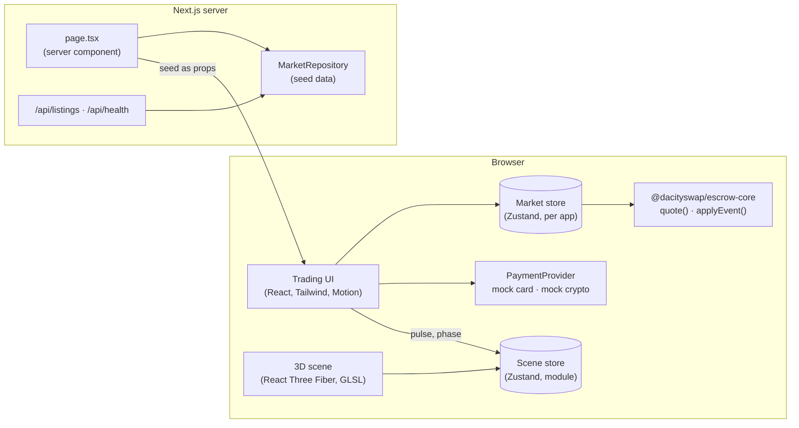
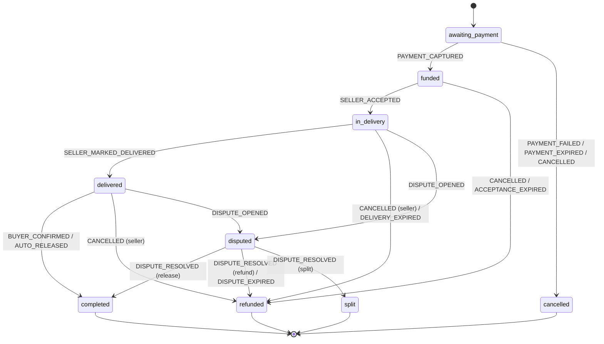
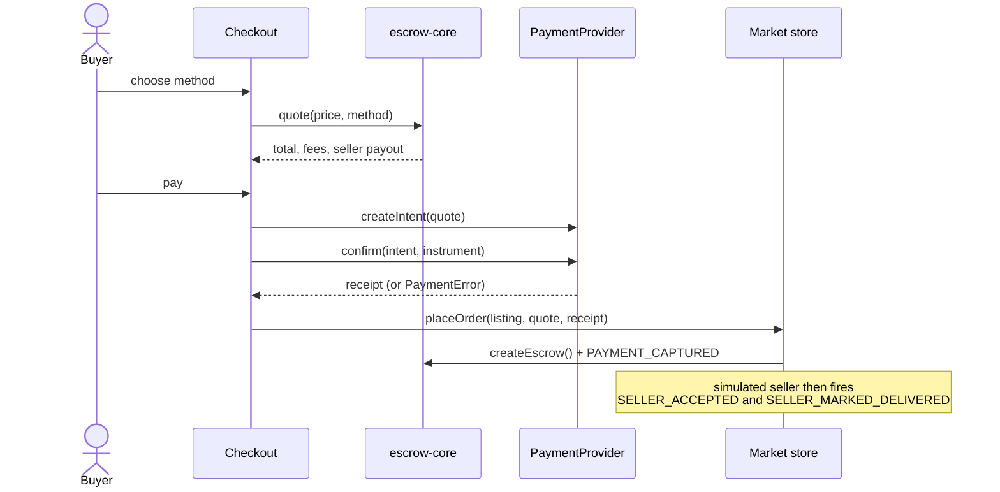
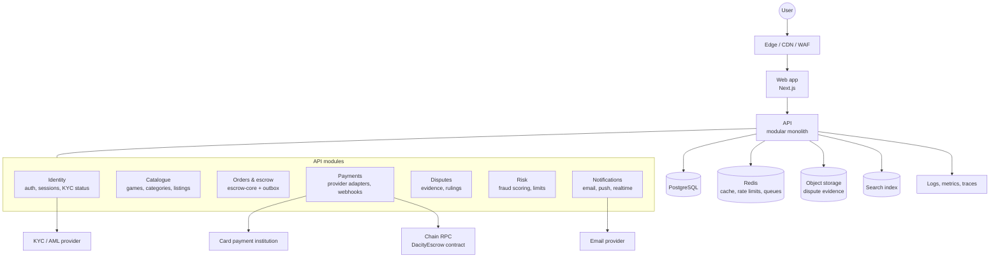
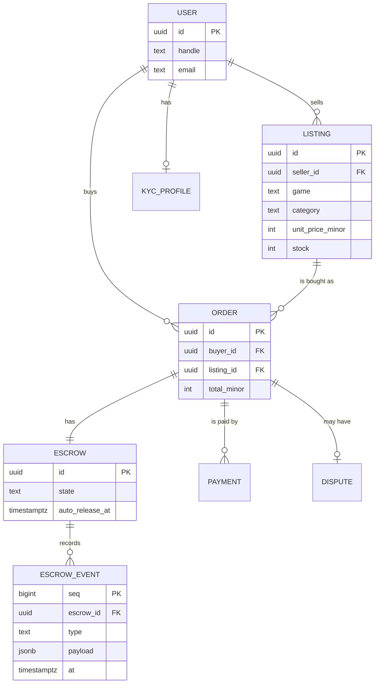

# Architecture

This document describes two things: how the demo in this repository works today, and the
production system it is designed to grow into. Where a section describes something that does
not exist yet, it says so.

- [1. Goals and constraints](#1-goals-and-constraints)
- [2. The demo today](#2-the-demo-today)
- [3. The domain core](#3-the-domain-core)
- [4. Payments](#4-payments)
- [5. The 3D scene](#5-the-3d-scene)
- [6. Target production architecture](#6-target-production-architecture)
- [7. Security](#7-security)
- [8. From demo to production](#8-from-demo-to-production)

## 1. Goals and constraints

| Goal                                                 | How the design answers it                                                                      |
| ---------------------------------------------------- | ---------------------------------------------------------------------------------------------- |
| Users must be able to trust how their money is held  | The escrow rules and fees are open source and are the same code the product runs               |
| The first screen must be the product                 | One viewport, no page scroll; the market panel is live on first paint                          |
| The demo must become the product, not be thrown away | Data and payments sit behind interfaces; simulators are swapped for real adapters              |
| It must feel fast on an ordinary laptop              | A handful of draw calls, adaptive quality, the scene loads outside the main bundle             |
| No game publisher's intellectual property            | Visuals are original or openly licensed; see [ADR 0004](adr/0004-procedural-original-scene.md) |

## 2. The demo today

Everything runs in the browser. The server only renders the page and serves seed data.



### Repository layout

```
apps/web/src/
├── app/                  Routes: the page, API handlers, global styles
├── components/
│   ├── app/              Shell: top bar, title card, drag surface, ticker, preloader, modals
│   ├── market/           Showroom menu, dock, market sheet, sell and orders views, price chart
│   ├── checkout/         Checkout flow
│   ├── scene/            The WebGL scene and its shaders
│   └── ui/               Buttons, modal, icons
├── config/               Site configuration
├── data/                 Seed dataset (deterministic)
├── domain/               Types, catalogue of games and categories, model registry
├── lib/payments/         Payment port and the two simulators
├── server/               Data-access port (MarketRepository)
└── store/                Client state
packages/escrow-core/     State machine, fee engine, money helpers, tests
packages/contracts/       DacityEscrow.sol and its Foundry tests
```

Dependencies point inwards. Components depend on `domain`, `store` and `lib`; those depend on
`escrow-core`; `escrow-core` depends on nothing.

### State

There are two stores, for a reason.

- **Market store** (`store/market-store.tsx`). Listings, orders, filters, modals and toasts. It
  is created once per mounted app and provided through React context, so nothing is shared
  between server requests.
- **Scene store** (`store/scene-store.ts`). Three values: the loading phase, a "scene is ready"
  flag and a pulse counter. The WebGL canvas runs in its own React reconciler and cannot read
  context from the DOM tree, so these few signals live in a module-level store both sides can
  import. It holds no user or market data.

### The no-scroll layout

`<main>` is fixed to the viewport and laid out as a showroom:

```
nav
title card  ·  stage (3D, drag to turn)  ·  menu
dock: categories and products
ticker with key hints
```

Two values in the market store drive it: `menuCategory`, the category the menu and the dock
are listing, and `selectedListingId`, the product on stage. Selecting a product updates the
title card, the menu's details and the model on stage (the store forwards the listing's model
id to the scene store). With nothing selected, the stage shows the brand coin.

The menu works like a console game's shop: one row is selected and drawn inverted, the arrow
keys move through rows and categories, and Enter buys. A transparent surface under the panels
turns pointer drags into rotation and the wheel into zoom.

The full market, swap, the sell form and the order list live in a sheet that opens over the scene.
While that sheet or a dialog is open, the scene stops rendering. On screens wider than 1024 px
the camera's projection is shifted left by half the menu's width and up by the dock's height,
so the stage stays centred in the space that is actually visible. On phones the menu is hidden
and its facts and actions move under the title.

## 3. The domain core

`packages/escrow-core` is pure TypeScript with no dependencies. It has four parts.

**Money** (`money.ts`). Every amount is an integer number of minor units. There is one rounding
rule, `bps()`, which rounds half up.

**Fees** (`fees.ts`). `quote()` turns a price and a payment method into everything both sides
need: what the buyer pays, what the seller receives and what the platform earns. A test sweeps
5,000 random inputs and checks that every cent the buyer pays is accounted for exactly once.

**Escrow** (`escrow.ts`). A trade is a state machine. `applyEvent()` returns a new record and
appends to its history, so every order carries its own audit trail, and `verifyRecord()`
replays that trail to check that a stored state follows from it. Three things sit on top of
the transition table:

- **Deadlines.** Every state that holds money has one, and a timeout event that fires when it
  passes. The party kept waiting gets the money: an order nobody accepts or delivers is
  refunded, a delivery nobody contests is paid out, a dispute nobody rules on is refunded.
- **Roles.** `applyEventAs()` refuses an event from an actor who may not send it.
- **Split rulings.** An arbiter can divide a disputed trade as well as award it whole.

**Settlement** (`settlement.ts`). `settle()` says where every cent of a finished trade went. A
randomised test checks that nothing is created or lost under any schedule, price or split.



The contract in `packages/contracts` implements the same machine for stablecoin payments, and
both are tested against one file of vectors (`packages/escrow-core/vectors/settlement.json`).
The full reference is the documentation site in `apps/docs`.

Two rules are enforced in code and covered by tests:

1. Funds are never released before the seller has marked delivery.
2. Automatic release is refused until the buyer's confirmation window has closed, and the
   clock stops while a dispute is open.

`packages/contracts/src/DacityEscrow.sol` implements the same machine on-chain for stablecoin
payments. Its key property is that the platform cannot withdraw escrowed funds: a trade's
principal can only go to that trade's buyer or seller. The contract is unaudited.

## 4. Payments

Checkout depends on one interface:

```ts
interface PaymentProvider {
  createIntent(input: { orderId: string; quote: Quote }): Promise<PaymentIntent>;
  confirm(intent, instrument, onProgress?): Promise<PaymentReceipt>;
}
```



A swap is not a second payment path. It builds a one-off listing for the requested amount of
cash at the index price, routes it to the most trusted cash seller and opens the same checkout,
so it gets the same quote, the same escrow and the same order record.

In the demo both providers are simulators (`mock-card.ts`, `mock-crypto.ts`). The composition
root is `lib/payments/index.ts`; replacing a simulator is a change to that file only.

How each rail is intended to work in production:

| Rail         | Custody of funds                                            | Notes                                                                                             |
| ------------ | ----------------------------------------------------------- | ------------------------------------------------------------------------------------------------- |
| Card         | A licensed payment institution's marketplace product        | Card data is entered in the provider's hosted fields and never reaches DacitySwap (PCI DSS SAQ A) |
| Stablecoin   | `DacityEscrow` contract, funded from the buyer's own wallet | Non-custodial by design                                                                           |
| Other crypto | To be decided                                               | Needs either conversion or a custodian. Both have licensing consequences                          |

Whether a given provider will accept this business at all is an open question. See the
[legal position](../apps/docs/resources/legal.md).

## 5. The 3D scene

The hero is a showroom: a boulevard at dusk after rain, with the selected product standing on it.

| Part       | Technique                                                                                                                                  |
| ---------- | ------------------------------------------------------------------------------------------------------------------------------------------ |
| Sky        | A public-domain photograph of Miami at dusk on a plane at the far end of the scene, softened and graded in a shader                        |
| Boulevard  | Generated geometry: two rows of palms and street lamps running to the vanishing point, for depth and parallax                              |
| Road       | A shader: wet asphalt with puddles that mirror the sky, lane markings, and a reflection traced onto the photo plane                        |
| Stage      | The selected product's glTF model from `domain/models.ts`. Vehicles stand on the street; smaller objects hover at eye level                |
| Reflection | On desktops, a planar mirror under the stage reflects the product, the palms and the sky, blurred like damp asphalt and faded at its edges |
| Shadow     | A contact shadow under the product ties it to the ground                                                                                   |
| Coin       | Generated geometry: grooved face, reeded edge, polished rim and mark                                                                       |
| Lighting   | A studio HDRI drives reflections; three directional lights give a warm rim, a cool edge and a soft fill                                    |
| Post       | Eight-sample antialiasing, light bloom, filmic tone mapping, a gentle vignette. No grain                                                   |

The camera is a long lens set low and tilted slightly up, the way cars are photographed. It
keeps the sky and the palms above the product instead of behind it.

Every model is normalised on load: turned to the pose in its registry entry, measured from
its actual vertices, scaled to a common size and centred on the turntable. Measuring from
vertices matters; the bounding boxes stored in some files are loose enough to leave a car
hovering a metre above the road.

When the selection changes, the current product stays on stage until the next one has loaded
(`useDeferredValue`), so the stage is never empty. Then the two trade places: a car pulls out
past the camera while the next drives up the boulevard and brakes; smaller things sink away
and drop in. Dragging sets a target rotation that the product follows with a little weight,
and the camera pushes in briefly on every change.

**Thumbnails and stickers come from the same models.** `/render` is an internal page that draws
one asset on a transparent background. `scripts/render-assets.mjs` opens it in Chrome and saves
a WebP per model, so a card always shows the product the stage will show.
`scripts/telegram-pack.mjs` uses the same page to capture turntable frames for Telegram.

To add a product model: compress it with glTF Transform into `public/models`, add it to
`domain/models.ts`, run `pnpm assets:render`, and credit its source in `CREDITS.md`.

Performance measures:

- The scene is imported dynamically, so three.js is not in the bundle that renders the UI.
- Models are compressed (meshopt geometry, WebP textures at 1K, or 2K for the hero models):
  52 files total about 41 MB, typically 0.2–2 MB each. Colourways reuse a file with a
  different paint, so 56 products need only 52 downloads. Desktops fetch them all in the background after first paint; phones
  and data-saver connections fetch a model only when it is picked.
- Thumbnails are WebP, about 15 KB each.
- The scene stops rendering while the market sheet, checkout or a dialog covers it.
- Desktops render at up to 2x pixel ratio with the reflection and eight-sample antialiasing.
  If the frame rate falls they first drop resolution, then the reflection and effects.
  Phones start on the lighter chain at up to 1.5x.
- `prefers-reduced-motion` stops the camera fly-in, parallax and idle rotation.
- If WebGL is unavailable, an error boundary removes the canvas and a CSS gradient shows
  instead. The app works either way.

## 6. Target production architecture

> Nothing in this section is built yet. It is the intended design.



Design choices and the reasons for them:

- **A modular monolith first.** One deployable with strict module boundaries. A small team ships
  and debugs it faster than a set of services, and a module can be extracted later if it needs
  to scale separately.
- **`escrow-core` runs on the server too.** The API applies the same `applyEvent()` the UI
  previews with. The server's result is authoritative; the client's is a preview.
- **Every state change is written with an outbox row** in the same database transaction.
  A worker publishes the outbox, so a notification or a payout can never be sent for a change
  that was rolled back.
- **Payment webhooks are idempotent.** Each provider event is stored by its id before it is
  processed, so a retry cannot capture or release twice.
- **Money columns are integers** with a currency code beside them, matching the core.

### Data model sketch



## 7. Security

In the demo:

- Security headers are set in `next.config.ts` (`nosniff`, frame denial, referrer and
  permissions policies).
- The demo is marked `noindex` while `demoMode` is on.
- No secrets exist. `.env*` files are ignored by git, with `.env.example` as the template.

For production, the items that matter most:

| Risk                                    | Control                                                                                   |
| --------------------------------------- | ----------------------------------------------------------------------------------------- |
| Account takeover                        | Passkeys or TOTP, mandatory for sellers; session binding; alerts on payout-detail changes |
| Stolen cards and chargebacks            | 3-D Secure, velocity limits, holding periods for new sellers, risk scoring                |
| Seller fraud (no delivery)              | Escrow by default, delivery evidence, reputation, staged limits                           |
| Collusion and laundering through trades | KYC for sellers, transaction monitoring, limits tied to verification level                |
| Smart contract bugs                     | Independent audit, deposit caps at launch, a small and simple contract                    |
| Insider abuse                           | Arbiter actions logged and reviewable; no platform path to escrowed principal on-chain    |
| Content Security Policy                 | A strict nonce-based policy, added once third-party scripts are known                     |

## 8. From demo to production

| Phase | Outcome                                                                                                                                 |
| ----- | --------------------------------------------------------------------------------------------------------------------------------------- |
| 0     | **Legal opinion and operating model.** Nothing else should start before this. See the [legal position](../apps/docs/resources/legal.md) |
| 1     | API, PostgreSQL, authentication. `MarketRepository` gets a database implementation                                                      |
| 2     | Seller onboarding with KYC; listings are persisted and moderated                                                                        |
| 3     | First real payment rail behind `PaymentProvider`, in the provider's sandbox                                                             |
| 4     | Buyer–seller chat, delivery evidence, dispute tooling                                                                                   |
| 5     | Contract audit, deployment to a test network, then a capped main-network launch                                                         |
| 6     | Observability, load testing, incident runbooks, closed beta                                                                             |
